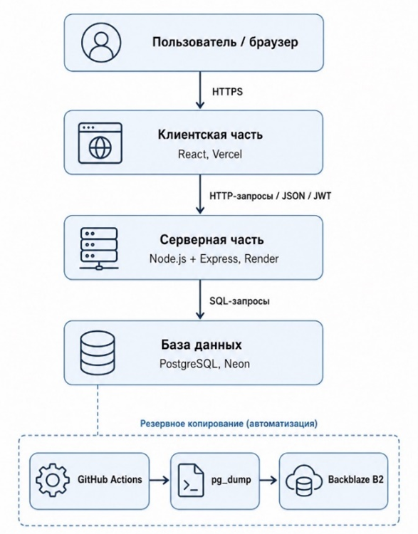
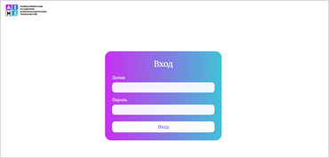
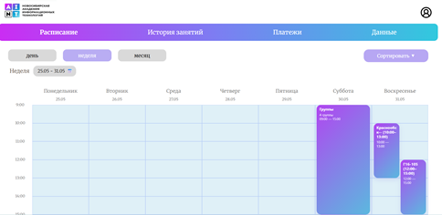
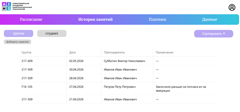
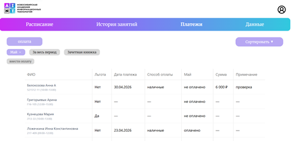
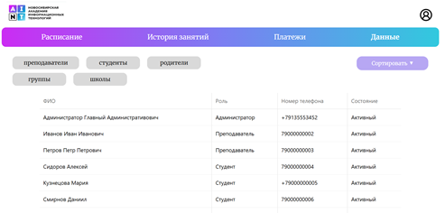
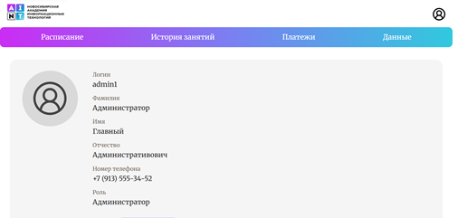
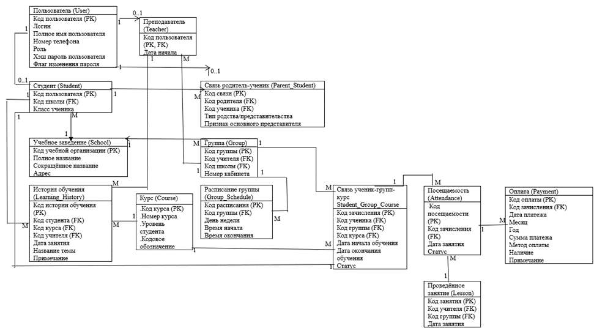
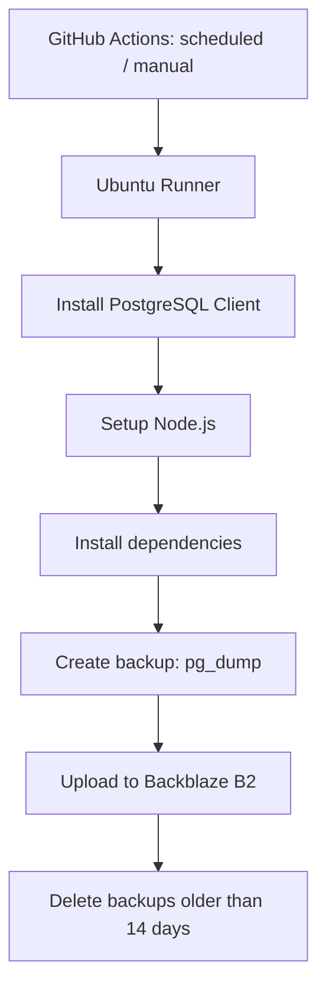

# NAIT — Education Management System

Информационная система управления школой дополнительного образования.
Разработана в рамках выпускной квалификационной работы бакалавриата НГТУ, 2026 г.

## О проекте

NAIT — полнофункциональное веб-приложение для автоматизации
управления учебным процессом в школе дополнительного образования.

Система объединяет управление пользователями, учебными группами,
расписанием, посещаемостью и платежами в едином информационном
пространстве.

Проект реализован с использованием клиент-серверной архитектуры,
REST API, реляционной базы данных и облачной инфраструктуры.

## Основные возможности

- Аутентификация и разграничение прав доступа пользователей.
- Управление учениками, родителями и преподавателями.
- Управление учебными группами, школами и курсами.
- Формирование расписания занятий.
- Ведение электронного журнала посещаемости.
- Просмотр истории занятий.
- Учёт платежей.
- Личные кабинеты пользователей.
- Автоматическое резервное копирование базы данных.

## Технологический стек

| Направление | Технологии |
|---|---|
| Backend | Node.js, Express.js, JavaScript |
| Frontend | React, TypeScript, Vite, CSS |
| Database | PostgreSQL, SQL, node-postgres |
| API | REST API, JSON |
| Authentication | JWT, bcrypt, RBAC |
| DevOps | GitHub Actions, GitHub Secrets, Linux, Bash |
| Cloud infrastructure | Render, Vercel, Neon |
| Cloud storage | Backblaze B2, AWS SDK, S3 API |
| Backup | pg_dump, Cron |
| Performance testing | Autocannon |
| Version control | Git, GitHub |

## Архитектура системы

Приложение построено на основе клиент-серверной архитектуры.

- Клиентская часть реализована на React и TypeScript.
- Серверная часть разработана на Node.js и Express.js.
- Взаимодействие клиента и сервера осуществляется через REST API.
- Для хранения данных используется PostgreSQL.
- Компоненты системы размещены на облачных платформах.



### Облачная инфраструктура

| Компонент | Платформа |
|---|---|
| Клиентское приложение | Vercel |
| Backend API | Render |
| База данных PostgreSQL | Neon |
| Резервные копии | Backblaze B2 |
| Автоматизация | GitHub Actions |

## Интерфейс приложения

### Авторизация



### Расписание занятий



### История занятий



### Учёт платежей



### Управление справочными данными



### Личный кабинет



## Backend

Серверная часть приложения реализована на Express.js
с разделением маршрутов, контроллеров, middleware
и вспомогательных модулей.

Основные компоненты:

- REST API для взаимодействия с клиентским приложением.
- Обработка запросов и бизнес-логики.
- Работа с PostgreSQL через пул подключений.
- Аутентификация пользователей с помощью JWT.
- Разграничение прав доступа на основе ролей.
- Хеширование паролей с использованием bcrypt.
- Скрипты резервного копирования базы данных.

## База данных

Для хранения информации используется реляционная
база данных PostgreSQL.

База данных содержит информацию о пользователях,
учениках, преподавателях, родителях, учебных группах,
курсах, школах, занятиях и платежах.

### ER-диаграмма



## DevOps и автоматизация

В проекте реализован автоматизированный процесс
резервного копирования PostgreSQL с использованием
GitHub Actions.

Конфигурация:

[.github/workflows/db-backup.yml](.github/workflows/db-backup.yml)

Workflow выполняется ежедневно в 22:00 UTC.
Также предусмотрен ручной запуск.

### Процесс резервного копирования



### Особенности реализации

- Выполнение задач в среде Ubuntu.
- Автоматическая установка зависимостей.
- Создание резервной копии с помощью pg_dump.
- Загрузка резервных копий в S3-совместимое хранилище.
- Автоматическое удаление копий старше 14 дней.
- Использование GitHub Secrets для передачи
  конфиденциальных параметров подключения.

## Безопасность

В приложении реализованы следующие механизмы:

- JWT-аутентификация.
- Ролевая модель доступа (RBAC).
- Хеширование паролей с помощью bcrypt.
- Проверка авторизации на серверной стороне.
- Использование переменных окружения.
- Использование GitHub Secrets в процессе автоматизации.

## Структура проекта

```text
Info_System/
├── .github/
│   └── workflows/
│       └── db-backup.yml
├── backend/
│   ├── controllers/
│   ├── middleware/
│   ├── routes/
│   ├── utils/
│   ├── db.js
│   ├── server.js
│   ├── stress-test.js
│   └── package.json
├── vite-project/
│   ├── public/
│   ├── src/
│   └── package.json
├── docs/
│   ├── screenshots/
│   ├── architecture.png
│   └── er-diagram.png
├── .gitignore
└── README.md
```

## Live Demo

[](https://info-system-frontend.vercel.app/)

Приложение развёрнуто в облачной инфраструктуре
и доступно онлайн.
